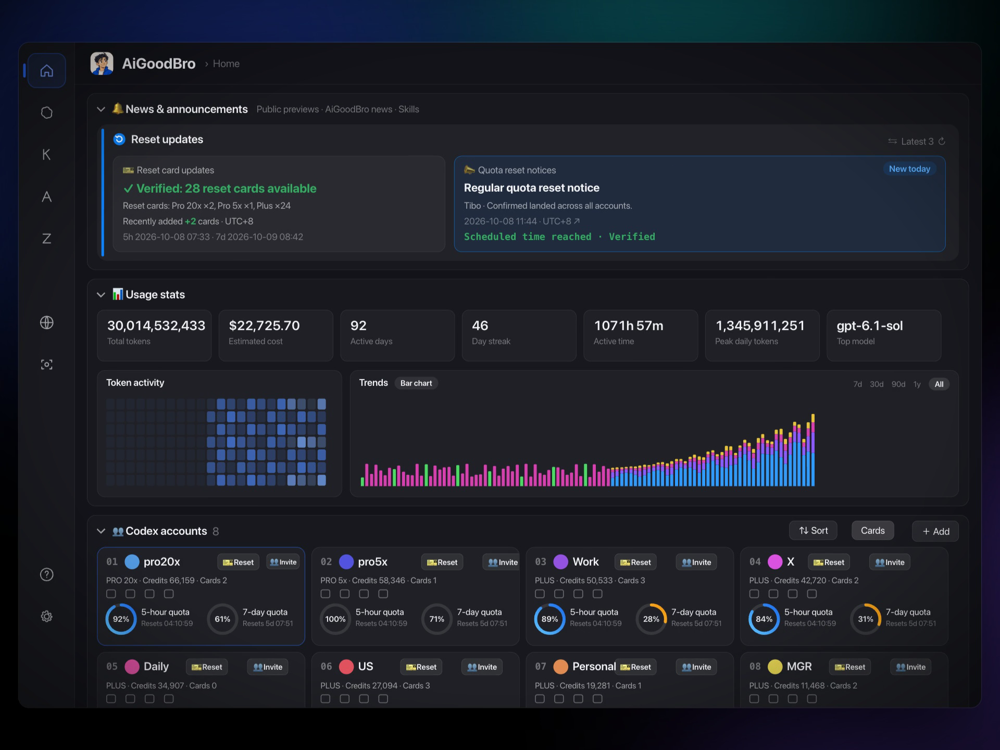
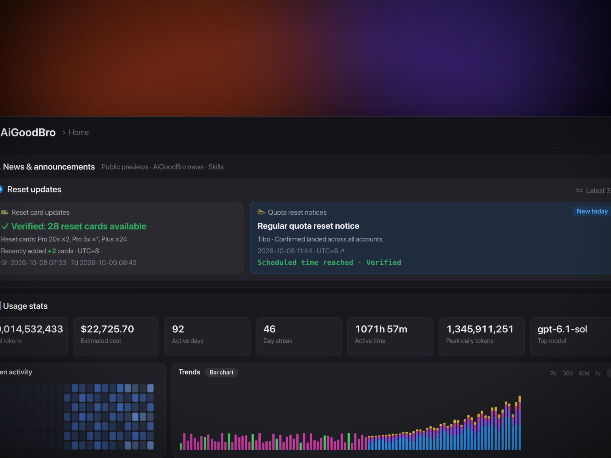
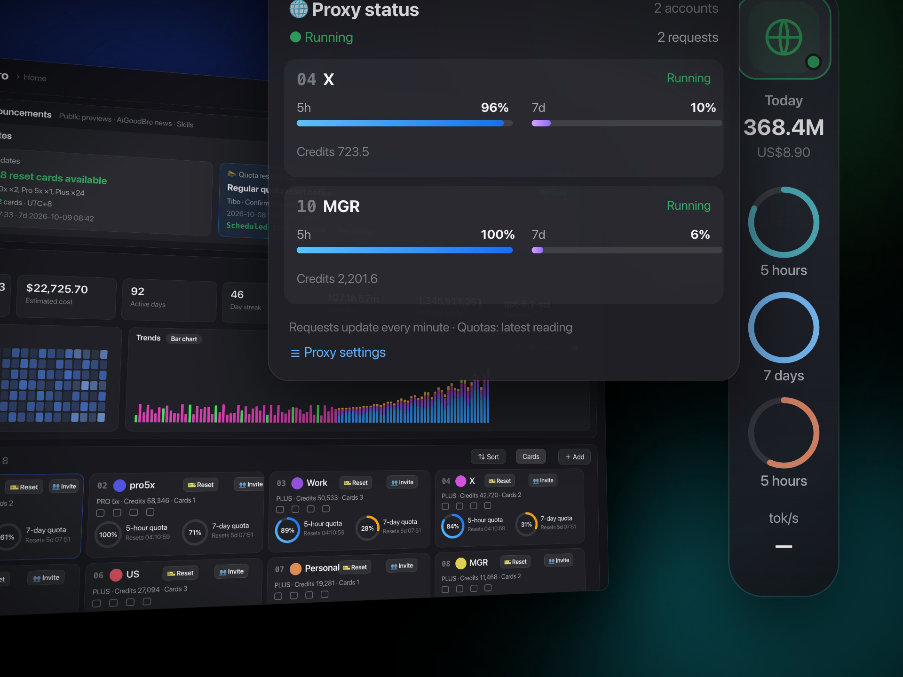
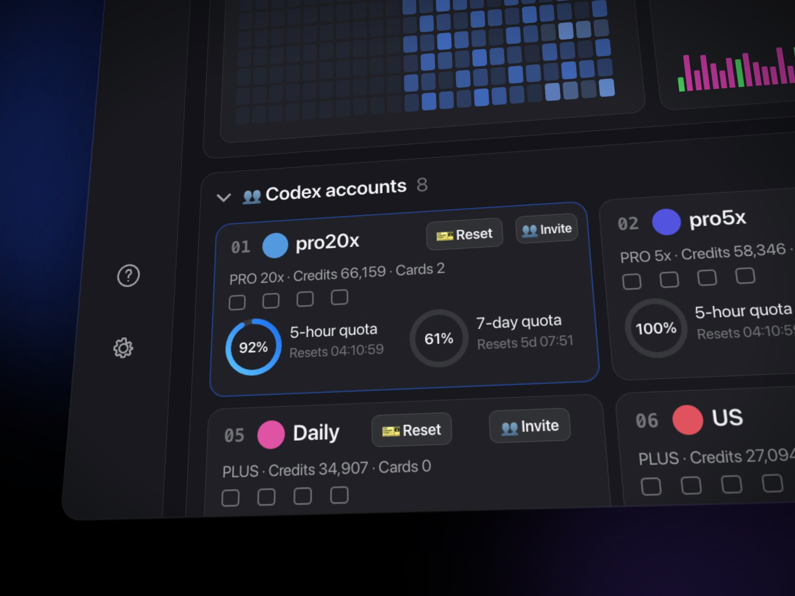
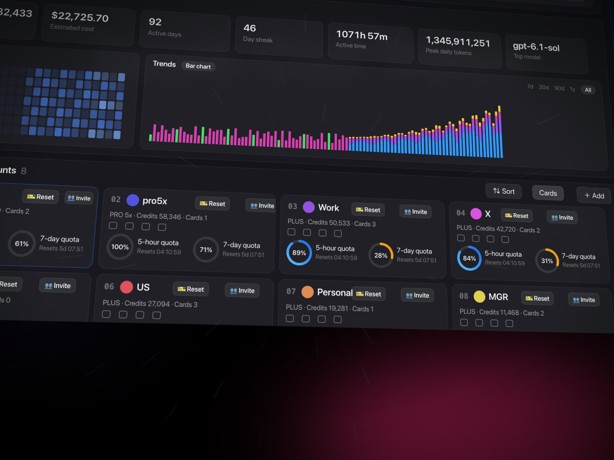
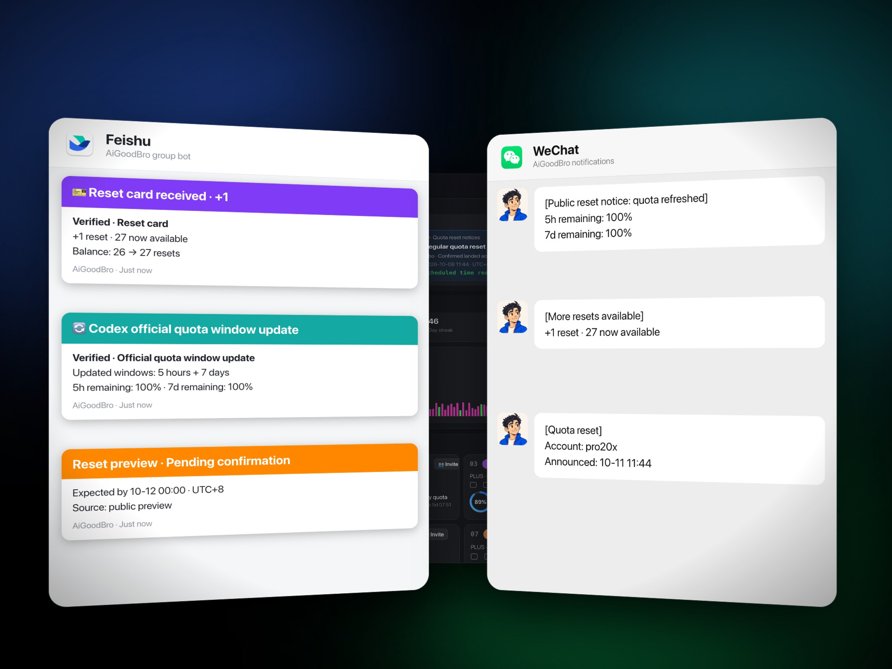
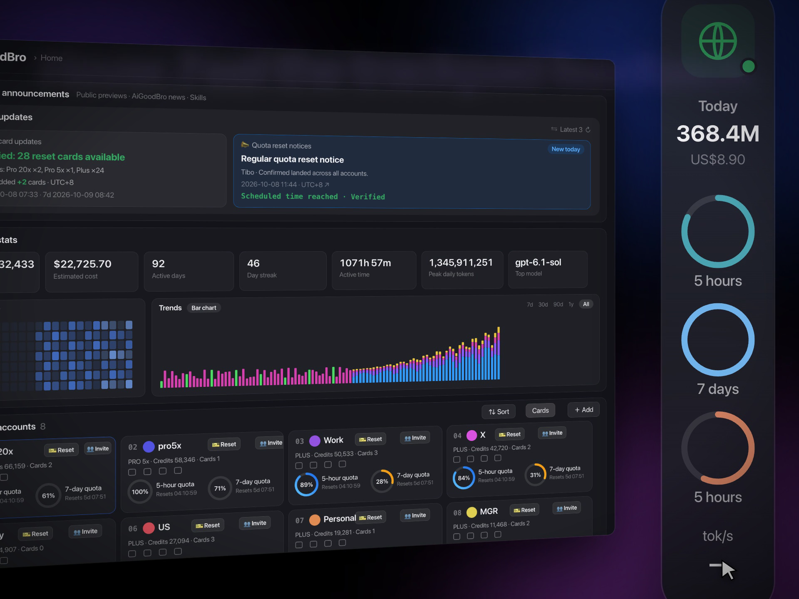

# AiGoodBro · AgentHub (2.5)

**See quotas, usage, reset messages and local work in one place; when needed, route work through your own Codex account pool.**

AiGoodBro is a macOS AI workspace for personal use. It brings together Codex accounts, Claude subscriptions, connected CLI status and quotas, Token usage, public reset messages and an optional local proxy. The interface supports Chinese and English; the home page is called AgentHub.

[中文](README.md) | **English**

This page describes **2.5.0 (143) · 1011v2**. It focuses on proxy control, quota cooldown recovery, rule saving and WeChat notifications while preserving existing custom behavior. Token Monitor 0.68.0, TokScale 4.18.0 and CLIProxyAPI 8.0.20 remain pinned to the 2.4 baseline. Find installers and the demo in [GitHub Releases](https://github.com/BLACKIELF/AgentHub-AiGoodBro/releases).

[DMG (Apple Silicon)](https://github.com/BLACKIELF/AgentHub-AiGoodBro/releases/download/v2.5.0/AiGoodBro-2.5.0-mac-arm64.dmg) · [ZIP](https://github.com/BLACKIELF/AgentHub-AiGoodBro/releases/download/v2.5.0/AiGoodBro-2.5.0-mac-arm64.zip) · [Release notes](docs/release-notes-v2.5.0.md)

**Promotional videos and interface showcase · 1012v1:** [Chinese original, 48 seconds (MP4)](https://github.com/BLACKIELF/AgentHub-AiGoodBro/releases/download/v2.5.0/AiGoodBro-demo-1011v4.mp4) · [English original, 48 seconds (MP4)](https://github.com/BLACKIELF/AgentHub-AiGoodBro/releases/download/v2.5.0/AiGoodBro-English-1011v1.mp4) · [English showcase and editable source](docs/showcase/1012v1/README.md) · [Complete English package (ZIP, with the English video)](https://github.com/BLACKIELF/AgentHub-AiGoodBro/releases/download/v2.5.0/AiGoodBro-Showcase-1012v2.zip)

The English showcase covers the original video's dashboard camera tour, reset countdown, Feishu and WeChat notifications, edge quota sidebar, proxy popover and multiple-account cards, with reproducible source.

[Main UI](#main) · [Reset messages](#reset-messages) · [Proxy](#proxy) · [Accounts](#accounts) · [Claude](#claude) · [Token Monitor](#usage) · [Other CLIs](#other-cli) · [Automatic reset-card use](#reset-cards) · [Invitations](#referrals) · [WeChat](#wechat) · [Feishu](#feishu) · [Sidebar](#dock) · [Task occupancy](#tasks) · [Setup and updates](#setup) · [Themes](#themes) · [Downloads](#downloads) · [Sources and docs](#sources) · [Actual app screenshots](#actual-screenshots)

<a id="main"></a>

## 01 · Main UI: see the whole workspace

**What it does:** The home page gathers the everyday view: announcements and reset messages at the top, connected tools and recommendations in the middle, Token usage below, and Codex accounts, Claude subscriptions and other tool states at the bottom. Public announcements, actual account quotas, local usage and task occupancy stay separate so numbers from different sources are not mixed.

**How to use it:** Launch AiGoodBro to open AgentHub. Expand or collapse a section from its heading; switch the account area between cards and rows. Section widths and selected display settings are kept locally.

**Image note:** The feature images below come from the promotional demonstration; account aliases, quotas and states are scripted. [Actual app screenshots](#actual-screenshots) are collected at the end.

<p align="center">
  <a href="docs/images/1012v1-promo/en/dashboard.png"></a>
</p>

**What the main numbers mean:**

- **Reset messages** are announcements and history from a public source, not a quota already verified for a particular account.
- **Available credits** are the account credit snapshot; **available amount (USD)** converts the same credits at the existing rate ($1 = 25 credits), rather than representing a separate balance. Unknown values are not shown as zero.
- **Token totals, cost and trends** come from local usage records. Cost is an estimate, not a provider bill.
- **Account cards** show identity, 5-hour / 7-day windows, reset times, reset cards and task occupancy. Unavailable data remains “—” or an explicitly marked older snapshot.

<a id="reset-messages"></a>

## 02 · Reset messages: read the announcement, then verify the account

**What it does:** The Reset messages section receives and displays public quota-reset announcements. It helps you see new reset notices, their content and confirmation state. It is separate from account quota reads, cannot replace account verification and does not redeem a reset card merely because a notice appears.

**How to use it:** Open Reset messages on the home page. “Recent 3” is a quick view; expand a message to see its source, time and state. The first read establishes a history baseline; later reads notify only new messages. A failed history read keeps verified content and marks the missing range.

<p align="center">
  <a href="docs/images/1012v1-promo/en/reset.png"></a>
</p>

Public messages do not rewrite official account records, change participation or priority, change credit floors or send a task. To use an expiring card, use the Automatic reset-card use section below and opt in per account.

<a id="proxy"></a>

## 03 · Local proxy: route requests through your account queue

**What it does:** The optional local proxy accepts model requests at a local endpoint and lets AiGoodBro select one of your connected accounts by participation, priority, Use last and saved order. It is for personal accounts and local work; it is not a public proxy and does not provide accounts or resell quota.

<p align="center">
  <a href="docs/images/1012v1-promo/en/proxy.png"></a>
</p>

**How to start and stop it:**

1. Open the AiGoodBro proxy panel and choose **Start proxy**. It does not start automatically after an app restart.
2. Wait for the connection details, quit Codex, then use **Connect Desktop** to relaunch it with the local route. An already-running Codex process does not switch routes automatically.
3. Choose **Stop proxy** when finished. Closing the main window only hides it; quitting the app asks whether to stop the service.

Participation, Priority, Use last and order affect new requests and stay synchronized with the account page. Pro20x defaults to Use last and can be changed. Temporary occupancy in the ordinary group is awaited within the existing admission deadline before Use last accounts. Exhausted or non-participating accounts are still skipped; identity, cooldown and quota checks remain. Subscription quota is used before credits; credit continuation is off unless the user enables it. Busy or unknown accounts are not treated as exhausted.

Disabling participation skips that account for admissions still waiting or retrying, while an admitted stream finishes. Gateway refusal, timeout, cancellation and ordinary forwarding failures have distinct messages; HTTP 503 remains and there is no automatic reconnect. Version 2.5 moves blocking reads off the cooperative executor and protects disconnected reply writes. Proven quota cooldowns are cleared only after newer subscription evidence is verified. For unknown legacy cooldowns, stop the proxy, choose Clear legacy cooldown on that account, verify fresh quota and identity, then confirm a backup and clear before restarting manually. Custom 5-hour used limits retain their saved values in both the editor and summary. Cleanup for a confirmed exited child briefly retries a busy lease lock up to three times while protecting a new run and active children. The historical fault that recovered only after a restart is not fully attributed, so this is not a permanent-stability guarantee.

<a id="accounts"></a>

## 04 · Codex accounts: quotas, reset cards and task occupancy

**What it does:** The account area puts multiple Codex identities on one page. Each card or row can show 5-hour / 7-day quota, reset times, credits, reset cards, the nearest expiry and task occupancy. Cards are for scanning; rows are for line-by-line adjustment. Refresh, order, notes, invitations and isolated CLI entry points remain available.

**How to use it:** Switch between Cards and List, refresh for a new snapshot, and use the info, settings or more action on a card for account operations. Participation, scheduling, priority and Use last keep their existing storage; proxy participation and priority share state with the proxy panel and apply to later requests.

<p align="center">
  <a href="docs/images/1012v1-promo/en/accounts.png"></a>
</p>

Narrow dedicated Codex list controls remain a next-version fix; use Cards or widen the window for now.

<a id="claude"></a>

## 05 · Claude subscriptions: official sign-in, save and switch

**What it does:** The Claude area manages Claude Code subscription identities, quota refresh and explicit manual switching. It shows 5-hour, 7-day and independent model limits separately, using only official values actually returned by the provider. Missing limits remain unknown.

**How to use it:** Sign in through the official Claude Code CLI, then return to AiGoodBro, verify the identity and choose **Add signed-in account / Save subscription**. Existing Claude-swap subscriptions can be linked. To add another account, save the current one, sign in to the other account in the official CLI and add it; do not run `/logout` first because saved credentials may become invalid. Saved subscriptions support manual switching and refresh.

Active or unknown-identity subscriptions cannot be unlinked. An expired target is refreshed through the Claude-swap flow only after the user explicitly chooses it.

<a id="usage"></a>

## 06 · Token Monitor: usage, heatmaps, trends and TPM

**What it does:** The embedded Token Monitor shows Token usage, estimated cost, activity heatmaps, trends, models, projects and sessions. Its upstream coverage is **35+ tools for Token tracking and 28+ providers for quota detection**. That describes upstream coverage, not a guarantee that every local tool is signed in or readable.

**How to use it:** Expand Usage statistics on the home page for totals, cost, heatmap and trend. Open the statistics entry from the sidebar or menu bar for detailed tool, model, project, session and quota views, then choose a time range or source. Token Monitor 0.68.0 and TokScale 4.18.0 update parsing and pricing and fix duplicate and cached Claude tokens.

<p align="center">
  <a href="docs/images/1012v1-promo/en/usage.png"></a>
</p>

Home, the floating bubble footer and sidebar share cached TPM (Tokens per minute), with no extra high-frequency polling.

<a id="other-cli"></a>

## 07 · Other CLIs: check connection and quota separately

**What it does:** This group keeps connected Kimi, Grok, OpenCode, WorkBuddy, ZCode and TRAE SOLO entries together, so “a login exists” is not confused with “a quota was actually read”. Upstream coverage does not mean that every local tool is connected.

**How to use it:** Choose a product in the setup guide or tool entry, complete that product's official sign-in, then return to AiGoodBro and refresh quota. Kimi CLI's older snapshot should be refreshed before use; Grok uses official `grok login --oauth`; OpenCode uses `opencode auth login`; WorkBuddy, ZCode and TRAE SOLO use their official desktop or CLI entry. Unknown, expired or unverified results remain “—” or an older snapshot instead of treating a process exit code as quota success.

Local authentication discovery, quota reads and subsequent model calls are checked separately. See [native CLI quota coverage](docs/local-cli-accounts.md) for boundaries.

<a id="reset-cards"></a>

## 08 · Automatic reset-card use: avoid forgetting an expiry

**What it does:** The account row shows only the nearest reset-card expiry, while hover reveals all known expiry times, keeping the layout on one line. Automatic use is designed to reduce the awkward “the card expired because I forgot it” situation; opening its settings does not redeem a card.

**How to use it:** On the home page or Codex account area, click the reset-card count, expiry time or info icon to open Automatic use before expiry. Opt in per account and set the lead time. It is off by default and defaults to **30 minutes** before expiry; the value can be changed from 1 to 1,440 minutes. Desktop or same-identity mirror accounts are attempted only after an independent entry, trusted identity and idle state are verified. An uncertain result pauses for manual review rather than retrying repeatedly.

Opt in per account and keep the app running; opening the settings does not redeem a card. See the [reset-card boundary](docs/reset-credit-control.md).

<a id="referrals"></a>

## 09 · Invitations: send and inspect referral credits

**What it does:** The account card keeps an invitation entry for batch invitations, official invitation status and referral credits.

**How to use it:** Choose the target account's invitation button or compact icon, complete the recipient and confirmation steps in the official window, then refresh the status. Send up to five addresses at a time. If the account or session changes, close and reopen the invitation window. Rewards depend on official conditions; accepting an invitation does not prove the credit has arrived.

<a id="wechat"></a>

## 10 · WeChat: quota and reset reminders

**What it does:** Personal WeChat can receive quota, reset and reset-card messages and, when explicitly enabled, continue a selected original Codex chat. Connection state and actual delivery remain separate.

**How to use it:** Open **Settings → Notifications / WeChat**, pair through Tencent's official iLink QR flow and confirm the conversation, then choose message types. The first read establishes a history baseline; later messages are new events only. Cached status queries do not consume account quota. An unfinished conversation stays labeled as waiting, not delivered.

<p align="center">
  <a href="docs/images/1012v1-promo/en/notifications.png"></a>
</p>

<a id="feishu"></a>

## 11 · Feishu: optional message delivery

**What it does:** Feishu can receive Agent status, account notes, quota, reset dates, reset-card expiry details and official balances. The default message stays compact and does not put long task IDs in the card body.

**How to use it:** Paste the bot address in the notification guide and choose **Save and connect**. If an existing connection needs Keychain permission, choose **Authorize connection**. The webhook is kept in macOS Keychain and is not written back to the UI or logs. A real test send requires an explicit user click; local authorization ready is not delivery proof.

The Feishu card and WeChat message image appears in the [WeChat section](#wechat).

<a id="dock"></a>

## 12 · Sidebar and status bubble: glanceable state

**What it does:** The edge sidebar gives a quick view of selected account quotas, reset countdowns, Token statistics and proxy state. Its expanded panel shows account rows, 5h / 7d rings and credits, reusing snapshots instead of polling continuously for animation.

**How to use it:** Press **⌘I** to show or hide it. The pin at the top can keep it visible; click again to hide. Hover for details and drag the top to move it. Settings provide ring or fish styles, 75–150% scaling, refresh controls, running indicators and trackpad haptics. Unavailable quota is “—”, not an inferred zero.

<p align="center">
  <a href="docs/images/1012v1-promo/en/sidebar.png"></a>
</p>

<a id="tasks"></a>

## 13 · Task occupancy, scheduling and warm-up

**What it does:** Local task records distinguish preparing, running, maintenance and awaiting-acceptance states so the account page and scheduler know which identities are occupied. Participation windows, priority and warm-up are existing automation controls; they do not automatically assign every account to a new task.

**How to use it:** In account automation or settings, enable “pause and switch at 1% remaining” or “automatically continue the original task after a successful switch” when desired. AiGoodBro saves the task and round, checks the backup account and task state, then switches. Warm-up refreshes after the quota window expires, then requests only when its evidence is valid; busy, low-quota or uncertain states wait or pause. Without trusted task evidence, it stays off and does not manufacture success notices.

<a id="setup"></a>

## 14 · Tool connections, install onboarding and update notices

**What it does:** For a detectable new or replacement installation, the guide separates sign-in, notification connections and new-feature settings and asks whether this is a new or returning user. New users go through the complete guide; returning users review WeChat, Feishu and new settings while keeping existing configuration. An in-place replacement whose identity cannot be reliably distinguished does not force a duplicate prompt. Manual Claude setup keeps its progress separate.

**How to use it:** Open the usage guide and connect official tools as needed. Claude, Kimi, Grok, OpenCode, WorkBuddy, ZCode and TRAE SOLO use their own official entry points. The update dialog shows version and changes; after the user starts a download, size and SHA256 are checked before the installer is opened. Downloading does not quit or replace the current app or enable optional features.

<a id="themes"></a>

## 15 · Themes and native glass

**What it does:** Appearance settings manage light/dark mode, palette, glass transparency and depth, keeping text readable across themes. macOS Reduce Transparency and Increase Contrast take precedence.

**How to use it:** Open **Settings → Display and icons** and choose palette, language and glass intensity. Nine themes remain available: Default, Liquid Keycap, Blue & White Porcelain, Monterey Dawn, A Thousand Li of Rivers, Dunhuang Apsara, Forbidden City Red, Violet Glow and WAICY Sunset. WAICY uses color values only; it does not copy brand graphics, fonts or mascots.

<a id="downloads"></a>

## 16 · Downloads, upgrades and builds

This version supports **macOS 13+ on Apple Silicon ARM64**. The package is locally ad-hoc signed and not Apple-notarized. Clients on 9.6.x need a manual download; 2.3 / 2.4 clients can discover 2.5. Users of local 2.5.0 (142) also need to replace it manually with build 143 because the product version is unchanged. Finish work, quit the old app normally, back up the old app and local data, replace it, then confirm 2.5.0 (143) / 1011v2 and review WeChat, Feishu and new settings.

The final candidate's native self-tests, resource checks, recursive signature checks, DMG / ZIP tree checks and SHA256 records are in the [2.5 release record](docs/release-notes-v2.5.0.md). They do not establish real account sign-in, provider calls, reset-card redemption, WeChat / Feishu delivery or global-hotkey acceptance; the installed build and real proxy path still require field verification.

```sh
git clone --branch v2.5.0 https://github.com/BLACKIELF/AgentHub-AiGoodBro.git AiGoodBro-2.5
cd AiGoodBro-2.5
make build
```

Builds require macOS, Go 1.26+ and the SHA256-verified Token Monitor 0.68.0 macOS runtime. Intel and Windows installers are not provided.

<a id="sources"></a>

## 17 · Sources, licenses and documentation

The table lists code and resources actually reused, adapted or consulted as static research. Licenses and copyright notices remain in the repository. Upstream test samples and brand assets are not presented as AiGoodBro capabilities.

| Project | Relationship |
|---|---|
| [Tencent/openclaw-weixin 2.4.9](https://github.com/Tencent/openclaw-weixin/tree/24de5c9eb0dd5e595d7e2d090ed8a3f82870d42c) | Native iLink protocol and QR-pairing adaptation; MIT notice retained, without installing OpenClaw. |
| [codexU](https://github.com/shanggqm/codexU) | Host adaptation and second development from the historical fixed source; AiGoodBro maintains the SwiftUI, quota, palette and Windows foundations. |
| [Token Monitor v0.68.0](https://github.com/Javis603/token-monitor/tree/5d2db368d8313415763860d594de00e46a663418) | Host adaptation of the pinned source and official macOS runtime; the statistics engine, dashboard, charts and resources remain bundled. |
| [TokScale 4.18.0 fork](https://github.com/Javis603/tokscale/tree/d5e8ad9b25bfafb43b5b6804940929b728a6f48a) · [original](https://github.com/junhoyeo/tokscale) | Pinned revision used for usage collection and pricing; its license remains bundled. |
| [CLIProxyAPI v8.0.20](https://github.com/router-for-me/CLIProxyAPI/tree/v8.0.20) | Host adaptation of the pinned Go scheduler, Codex executor and Responses handler, preserving identity, quota, credit-floor and no-replay checks. |
| [Codex-Manager](https://github.com/qxcnm/Codex-Manager) | Protocol adaptation and static research reference; warm-up and SSE completion rules are independently implemented. |
| [Hazmat wrapper script](https://github.com/dredozubov/hazmat/blob/c112d222bb53e888dd17a8927927286792f7c20e/scripts/check-codex-desktop-attach-smoke.sh) | Static reference for the `CODEX_CLI_PATH` stdio wrapper entry point; no Hazmat sandbox or service is integrated. |
| [BlackHole1/aswap v1.1.0](https://github.com/BlackHole1/aswap/releases/tag/v1.1.0) | Static protocol and design reference for a Claude multi-account CLI / Chrome profile tool; not copied or bundled. |

AiGoodBro is released under the [MIT License](LICENSE). Third-party notices are in [`Resources/THIRD_PARTY_NOTICES.txt`](Resources/THIRD_PARTY_NOTICES.txt), [`Companion/LocalProxy/LICENSE.CLIProxyAPI`](Companion/LocalProxy/LICENSE.CLIProxyAPI), [`Companion/LocalProxy/LICENSE.Hazmat`](Companion/LocalProxy/LICENSE.Hazmat) and [`Companion/LocalProxy/THIRD-PARTY-NOTICES.txt`](Companion/LocalProxy/THIRD-PARTY-NOTICES.txt).

Documentation: [detailed guide](docs/usage-guide.md) · [native CLI quota coverage](docs/local-cli-accounts.md) · [proxy implementation and validation](docs/local-proxy-0928v1.md) · [2.5 release record](docs/release-notes-v2.5.0.md) · [image sources and checksums](docs/public-ui-1012v1-promo.md) · [issues](https://github.com/BLACKIELF/AgentHub-AiGoodBro/issues) · [security](SECURITY.md)

<a id="actual-screenshots"></a>

## 18 · Actual app screenshots

The home capture and its account and usage crops come from installed **2.3.0 (137)**. The six sign-in, guide and settings images come from **2.3.0 (139)**, whose settings presentation is retained in 143. The proxy-status crop has no visible build number. Values and connection states are capture-time snapshots, not acceptance of a build 143 installation, real model calls or message delivery. See the [historical image record](docs/public-ui-1009v2.md) for sources, original dimensions and checksums. Click an image to open the original.

### 01 · Main UI

<p align="center">
  <a href="docs/images/1009v1/home-live.png"></a>
</p>

### 02 · Proxy status and sidebar

<p align="center">
  <a href="docs/images/1009v1/proxy-status-edge-dock.png"></a>
</p>

### 03 · Codex accounts

<p align="center">
  <a href="docs/images/1009v2/accounts-home-137-crop.png"></a>
</p>

### 04 · Claude sign-in and save

<p align="center">
  <a href="docs/images/1009v2/claude-login.jpg"></a>
</p>

### 05 · Usage statistics

<p align="center">
  <a href="docs/images/1009v2/usage-home-137-crop.png"></a>
</p>

### 06 · Tool connection guide

<p align="center">
  <a href="docs/images/1009v2/guide.jpg"></a>
</p>

### 07 · Automatic reset-card use settings

<p align="center">
  <a href="docs/images/1009v2/reset-auto.jpg"></a>
</p>

### 08 · WeChat and Feishu notification settings

<p align="center">
  <a href="docs/images/1009v2/notifications-guide.jpg"></a>
</p>

### 09 · Sidebar settings

<p align="center">
  <a href="docs/images/1009v2/edge-dock-settings.jpg"></a>
</p>

### 10 · Themes and glass settings

<p align="center">
  <a href="docs/images/1009v2/appearance-settings.jpg"></a>
</p>
