# AiGoodBro · AgentHub（3.0.0）

**把额度、用量、重置消息和本机任务放在一页看清；需要时，让任务使用自己的 Codex 账号池。**

AiGoodBro 是面向个人自用的 macOS AI 工作台。它集中查看 Codex 多账号、Claude 订阅、已连接 CLI 的额度与状态，统计 Token 用量，接收公开重置消息，并提供可选的本地反代。界面支持中文和 English，主页名称为 AgentHub。

[中文] | [English](README.en.md)

**当前发布版本：3.0.0（161）· 1028v1。** 修复主页统计与使用时长显示，反代停止与清理改为后台限时处理，二次确认后可强制退出；保留已有账号、规则与外观，并收录此前通过审查的用量解析、消息凭据恢复和上游适配。软件内更新介绍同步。[发布与下载](https://github.com/BLACKIELF/AgentHub-AiGoodBro/releases/tag/v3.0.0) · [完整变化与验证边界](docs/release-notes-v3.0.0.md)。

**Windows 3.0.0 独立发布。** 提供本地工作台、目录关联、额度读取和隔离终端工作流，按 Windows 构建与测试，不要求与 macOS 功能完全一致。[Windows 功能和安装说明](windows/README.md)。

下载：[DMG（Apple Silicon）](https://github.com/BLACKIELF/AgentHub-AiGoodBro/releases/download/v3.0.0/AiGoodBro-3.0.0-mac-arm64.dmg) · [macOS ZIP 备用包](https://github.com/BLACKIELF/AgentHub-AiGoodBro/releases/download/v3.0.0/AiGoodBro-3.0.0-161-1028v1-mac-arm64.zip) · [Windows MSI](https://github.com/BLACKIELF/AgentHub-AiGoodBro/releases/download/v3.0.0/CodexAccountManagerNext-3.0.0-windows-x86_64.msi) · [Windows EXE](https://github.com/BLACKIELF/AgentHub-AiGoodBro/releases/download/v3.0.0/CodexAccountManagerNext-3.0.0-windows-x86_64-setup.exe)

**宣传片与界面展示 · 1012v1：** [中文原片（48 秒 MP4）](https://github.com/BLACKIELF/AgentHub-AiGoodBro/releases/download/v2.5.0/AiGoodBro-demo-1011v4.mp4) · [English（48 秒 MP4）](https://github.com/BLACKIELF/AgentHub-AiGoodBro/releases/download/v2.5.0/AiGoodBro-English-1011v1.mp4) · [英文展示源码](docs/showcase/1012v1/README.md) · [英文完整资料包（ZIP，含英文原视频）](https://github.com/BLACKIELF/AgentHub-AiGoodBro/releases/download/v2.5.0/AiGoodBro-Showcase-1012v2.zip)

英文展示页整理主界面巡游、重置倒计时、飞书／微信消息、屏幕边缘侧栏、反代浮窗和多账号卡片，并附可复现源码。

[主界面](#main) · [重置消息](#reset-messages) · [反代](#proxy) · [账号](#accounts) · [Claude](#claude) · [Token Monitor](#usage) · [其他 CLI](#other-cli) · [重置卡自动使用](#reset-cards) · [邀请](#referrals) · [微信](#wechat) · [飞书](#feishu) · [侧栏](#dock) · [任务占用](#tasks) · [引导与更新](#setup) · [主题](#themes) · [下载与构建](#downloads) · [源码与文档](#sources) · [实际软件截图](#actual-screenshots)

<a id="main"></a>

## 01 · 主界面：一页看清工作状态

**它是做什么的：** 主界面把最常用的状态集中起来：顶部是公告和重置消息，中央是已连接工具与推荐入口，下面是 Token 用量统计，底部是 Codex 账号、Claude 订阅和其他工具状态。公开公告、账号真实额度、用量统计和任务占用分开显示，避免把不同来源的数字混在一起。

**怎么进入：** 启动 AiGoodBro 后进入 AgentHub 主页；点击分区标题可展开或收起，账号区可在“卡片／列表”间切换，分区宽度和部分缩放设置会保存在本机。

**图片说明：** 前部配图取自宣传片演示界面，账号别名、额度与状态为脚本内容；[实际软件截图](#actual-screenshots)集中展示在文末。

<p align="center">
  <a href="docs/images/1012v1-promo/zh/dashboard.png">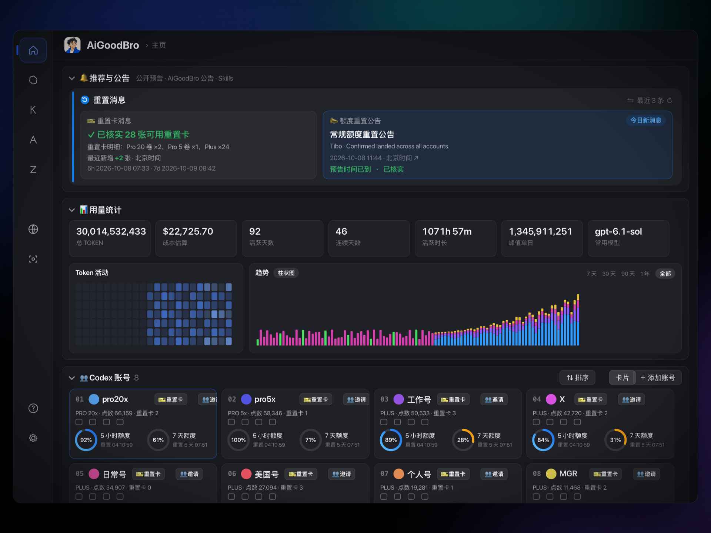</a>
</p>

**主界面上几个数字各自代表什么：**

- **重置消息**是公开消息源的公告和历史记录，不等于某个账号已经读到的官方额度。
- **可用点数（点）**是已读取账号的点数快照；**可用金额（美元）**由同一份点数按现有比例换算（1 美元 = 25 点），不是另一笔余额；未知值不写成 0。
- **Token 总量、成本和趋势**来自本机用量记录；成本是估算值，不是供应商账单。
- **账号卡片**显示账号身份、5 小时／7 天窗口、重置时间、重置卡和任务占用；缺少可信返回时显示“—”或旧快照标记。

<a id="reset-messages"></a>

## 02 · 重置消息：先看公开公告，再核对账号

**它是做什么的：** “重置消息”用于接收和查看公开的额度重置公告，帮助判断最近是否出现新的重置、公告内容和待确认状态。它与账号额度读取分开，不能用公告替代账号核验，也不会因为看到公告就自动兑换重置卡。

**怎么使用：** 在主页的“重置消息”分区打开消息列表；“最近 3 条”用于快速浏览，展开后可查看公告来源、时间和状态。首次建立历史基线，之后只提示新消息；历史读取失败会保留已核验内容并标出缺口。

<p align="center">
  <a href="docs/images/1012v1-promo/zh/reset.png">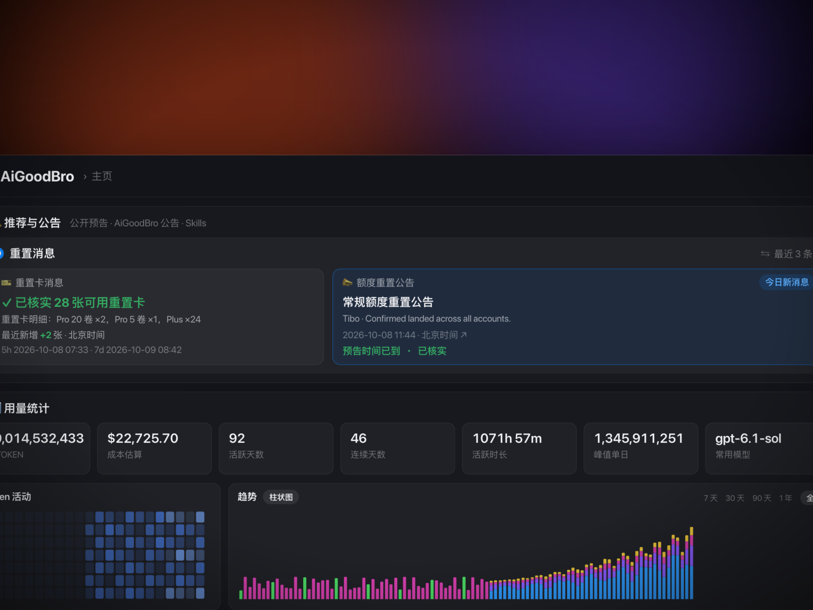</a>
</p>

**消息和账号数据的边界：** 公开消息不会改写账号官方重置记录，不会改变参与调度、优先级或点数底线，也不会自动发送任务。若要执行重置卡，请使用下方的“重置卡自动使用”入口，并逐账号明确开启。

<a id="proxy"></a>

## 03 · 本机反代：把请求交给自己的账号队列

**它是做什么的：** 本地反代是一个可选的本机服务。兼容客户端把模型请求发到本机端点，AiGoodBro 再按照账号的参与状态、优先级、最后使用和保存顺序选择本人已经连接的账号。它适合个人账号池和本机任务，不是公共代理，也不提供账号或额度转售。

<p align="center">
  <a href="docs/images/1012v1-promo/zh/proxy.png">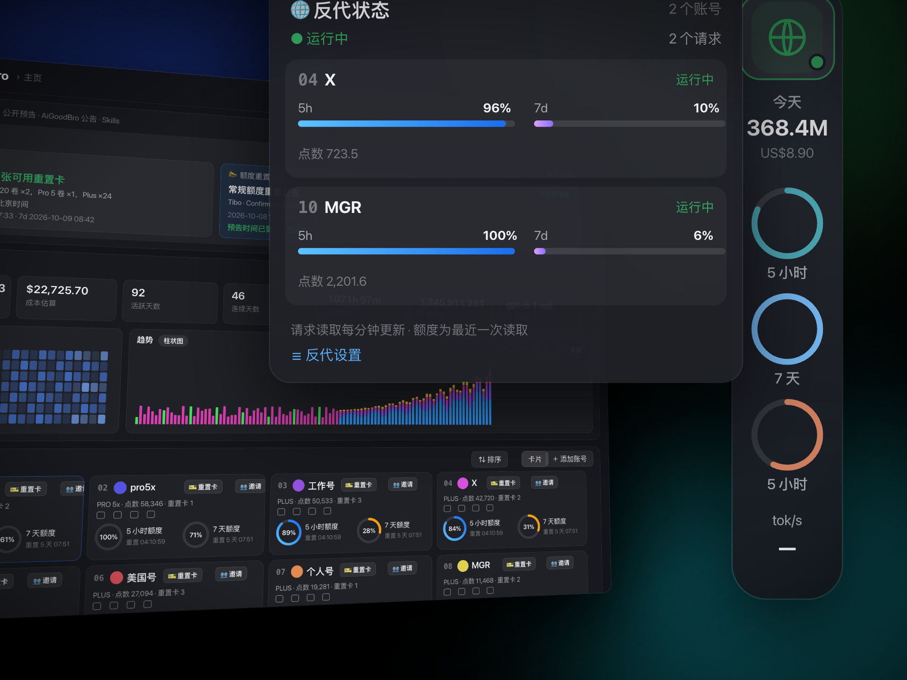</a>
</p>

**怎么开启：**

1. 在 AiGoodBro 的反代面板手动点击“开启反代”；应用重启后不会自动启动。
2. 等待连接信息就绪，退出 Codex 后使用“接入桌面”重新启动并接入本机路由。已经运行的 Codex 进程不会自动改走反代。
3. 完成任务后在面板点击“停止反代”。关闭主窗口只会隐藏窗口；退出应用时会询问是否停止服务。

**队列怎么工作：** 参与、优先、最后使用和排序只影响新请求，并与账号页同步；已核实的 Pro 账号默认最后使用，可调整，手动倍率标签不决定路由。普通组暂时忙碌时先在原有时限内等待，不立即转用最后使用账号。额度不足或未参与的账号继续跳过；身份、冷却和额度检查保持。订阅额度先于点数，点数接续默认关闭，用户主动开启后才会在额度耗尽时进入点数档。忙碌或未知账号不会被当成额度耗尽。

运行中取消参与后，尚未准入的等待和重试会跳过该账号，已经接入的流式响应继续完成。网关拒绝、超时、取消和普通转发失败分别提示；HTTP 503 保留，不自动重连。2.5 把阻塞读取移出协作线程池，并保护断线回包；有明确来源的额度冷却，仅在核验更新的订阅额度后解除。来源不明的旧冷却，可停止反代后在对应账号下选择“清理旧版冷却…”，通过最新额度和身份核验、备份确认后清理，再手动重新开启反代。Plus 自定义 5 小时已用上限按保存值执行，规则摘要与编辑框保持一致；Pro 保留旧值，但不将该上限用于准入。已确认退出的子进程清理租约时，忙碌锁最多短暂重试 3 次，并保护新的运行和仍活跃的子进程。本版进一步区分共享状态锁竞争与真实占用，等待和重试遵守原期限及取消信号，超时提供稍后重试提示；已发送响应不自动重放。CLIProxyAPI 更新至 8.0.38，保留多行流式响应解析和连接关闭分类，并增加并发冷却保护与工具调用兼容修复。历史“必须重启才恢复”的故障根因仍未完全确认，不能把本次修复写成永久稳定保证。

本版还提供统一的 Plus 账号 5 小时已用上限，支持批量应用后逐账号调整；低于 100% 时达到上限停止新请求，已有响应继续完成。100% 沿用原有点数接续规则，Pro 规则保留。

<a id="accounts"></a>

## 04 · Codex 账号：额度、重置卡和任务占用

**它是做什么的：** 账号区把多个 Codex 身份放在同一页，显示 5 小时／7 天额度、重置时间、点数、重置卡、最近到期时间和任务占用。卡片适合快速浏览，列表适合逐行调整；刷新、排序、备注、邀请和独立 CLI 入口保留。

**怎么使用：** 点击账号区的“卡片／列表”切换；点击刷新读取最新快照；点击账号卡中的信息、设置或更多按钮查看动作。参与、调度、优先和最后使用等入口按现有功能各自保存，反代参与和优先会与反代面板同步，并用于后续新请求。

<p align="center">
  <a href="docs/images/1012v1-promo/zh/accounts.png">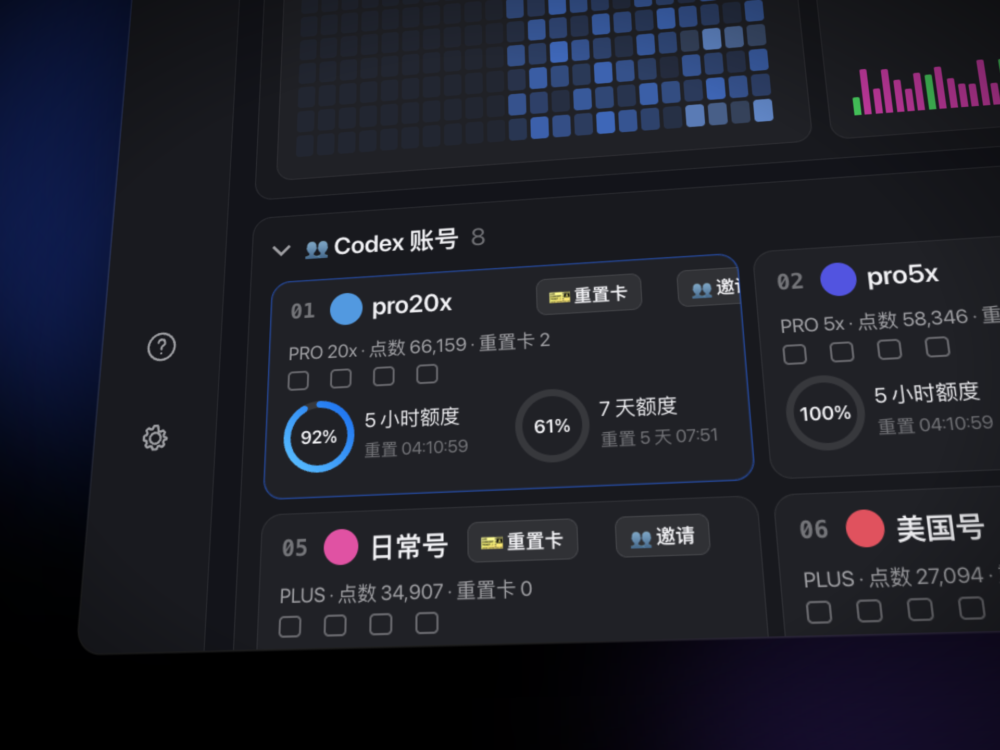</a>
</p>

本版将 Codex 专用列表的“反代／调度”和“优先／最后使用”分组排列，窄窗口下整组换行；保留卡片模式、原有开关与保存行为。

<a id="claude"></a>

## 05 · Claude 订阅：官方登录、保存和切换

**它是做什么的：** Claude 区用于管理 Claude Code 订阅身份、刷新额度和手动切换；它把 5 小时、7 天和官方实际返回的独立模型额度分开显示，缺失额度保持未知。

**怎么使用：** 先在官方 Claude Code CLI 完成登录，再在 AiGoodBro 里核验身份并点击“添加当前登录账号／保存订阅”。已有 Claude-swap 订阅可以关联；要添加另一个账号，先保存当前订阅，再回到官方 CLI 登录另一个账号后添加。不要先 `/logout`，否则可能使已保存凭据失效。保存后可手动切换和刷新额度。

活跃或身份未知的订阅不能解除关联，过期目标只有用户明确切换时才按 Claude-swap 流程续期。本版对齐 Claude-swap 0.27.1 的配置路径规则：空旧配置不再遮住当前配置，保存与切换核对同一文件及身份，失败恢复只处理本次持有的写入。

<a id="usage"></a>

## 06 · Token Monitor：用量、热图、趋势和 TPM

**它是做什么的：** 内置 Token Monitor 用来集中查看 Token 用量、估算成本、活动热图、趋势、模型、项目和会话；上游覆盖 **35+ 种工具的 Token 用量追踪、28+ 家提供方的额度检测**。这是上游支持范围，不代表本机每个工具都已经登录或能读取额度。

**怎么使用：** 主页展开“用量统计”查看总量、成本、热图和趋势；从侧栏或菜单栏打开统计入口查看更细的工具、模型、项目、会话和额度视图，再选择时间范围或数据来源。本版保留 Token Monitor 0.68.0 界面及现有设置，选择性回移 0.70 的日志读取与计价修复，以及 0.71 的归档后台交接、读取失败保留完整统计和菜单栏浮窗关闭修复；不是完整升级到 0.71。TokScale 保留 4.18.0 基线，采用固定修订的扫描器。

<p align="center">
  <a href="docs/images/1012v1-promo/zh/usage.png">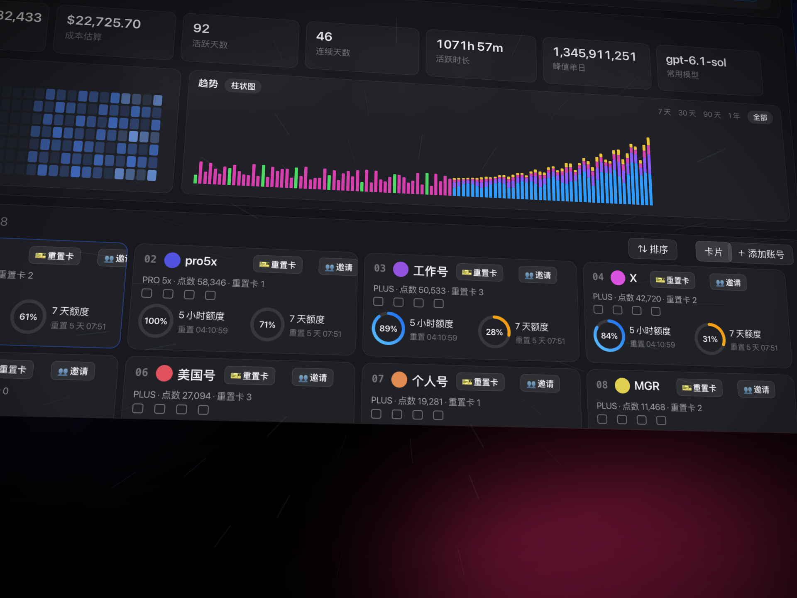</a>
</p>

顶部、浮窗底部和侧栏共用缓存的 TPM（每分钟 Token 消耗量），不为显示速率额外频繁刷新。

<a id="other-cli"></a>

## 07 · 其他 CLI：连接状态和额度分开核对

**它是做什么的：** 这一组入口把已经连接的 Kimi、Grok、OpenCode、WorkBuddy、ZCode 和 TRAE SOLO 集中列出，方便知道“登录是否存在”和“额度是否真的读到”是两件事。上游支持数量不等于本机已经接通数量。

**怎么使用：** 在“使用引导”或工具入口选择对应产品，按该产品的官方登录方式完成登录，再回到 AiGoodBro 点击刷新额度。Kimi CLI 的旧快照使用前要刷新；Grok 使用官方 `grok login --oauth`；OpenCode 使用 `opencode auth login`；WorkBuddy、ZCode 和 TRAE SOLO 只使用各自官方桌面或 CLI 入口。未知、过期或没有可信返回时，界面保留“—”或旧快照，不把退出码当成额度成功。

本机认证配置发现、额度读取与后续模型调用分别核对。详细覆盖边界见[本机 CLI 额度范围](docs/local-cli-accounts.md)。

<a id="reset-cards"></a>

## 08 · 重置卡自动使用：减少临期忘记操作

**它是做什么的：** 账号旁只显示最近一张重置卡的到期时间，鼠标悬停可查看全部已知到期时间，避免增加卡片行数。临期自动使用用于减少“卡到期了才想起来”的浪费，不会因为打开入口就自动扣卡。

**怎么使用：** 在主页或 Codex 账号区点击“重置卡 N”、到期时间或信息按钮，进入“到期自动使用”；逐账号选择是否开启，并设置提前时间。默认关闭、默认提前 30 分钟，可调整为 1–1440 分钟。桌面账号或同身份镜像只在独立入口、可信身份和空闲状态都核验通过时尝试；结果不明会暂停并提示人工核对，不反复重发。

使用前必须逐账号授权，并保持应用运行；设置页本身不会兑换卡片。本版还会记录已核实可用次数的增加与减少，并对已知到期时间进入 24 小时内的卡，沿用用户已开启的消息通道提醒。首次同步不补发历史变化；提醒不兑换卡片，发送结果不确定时暂停重发。详细边界见[重置卡说明](docs/reset-credit-control.md)。

<a id="referrals"></a>

## 09 · 邀请好友：邀请和点数集中查看

**它是做什么的：** 账号卡保留邀请入口，用于批量邀请、查看官方邀请状态和邀请点数，省去切换到其他页面核对。

**怎么使用：** 点击目标账号的邀请按钮或小图标，按官方页面完成收件人填写和确认，再刷新查看状态。每次最多 5 个地址；账号或登录状态变化时应关闭并重新打开邀请窗口。奖励到账以官方条件和返回结果为准，接受邀请不等于点数已经到账。

<a id="wechat"></a>

## 10 · 微信：额度和重置提醒

**它是做什么的：** 个人微信用于接收额度、重置和重置卡消息，也可以在用户明确开启后继续指定的 Codex 原聊天。连接状态和消息是否真正送达分开显示。

**怎么使用：** 在“设置 → 通知／微信”进入连接引导，使用腾讯官方 iLink 扫码绑定；确认会话后选择要接收的消息类型。首次建立历史基线，之后只发送新消息；查询缓存状态不会消耗账号额度。微信未完成会话时，界面显示等待状态，不把“已配置”写成“已送达”。本版修复启动时调整通知内容中断已保存连接读取的问题，完整任务回复按字节安全分段；升级后微信、飞书可能仍需 macOS 钥匙串授权，授权本身不会发送测试消息。

<p align="center">
  <a href="docs/images/1012v1-promo/zh/notifications.png">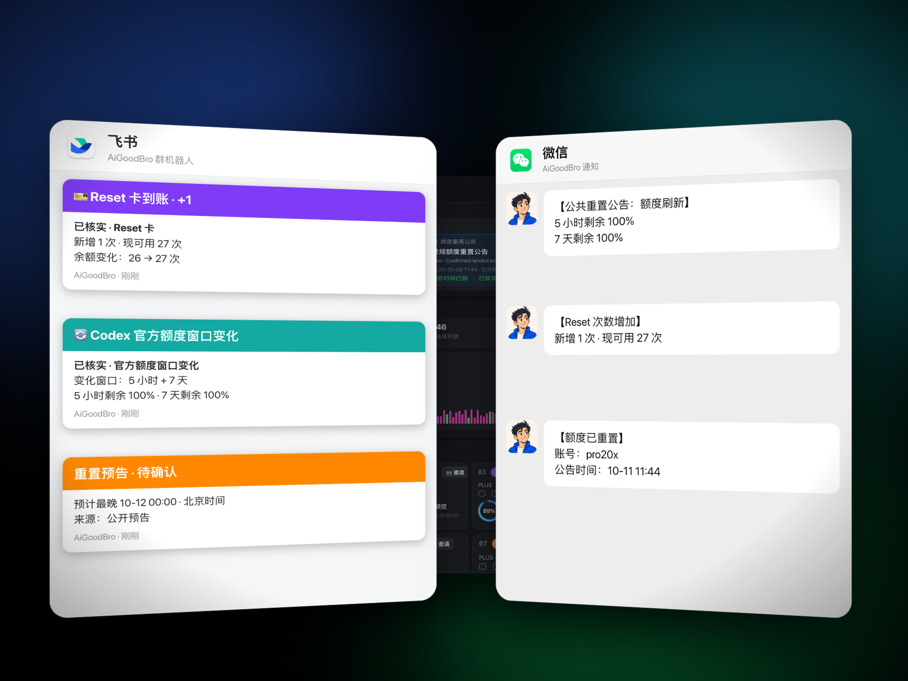</a>
</p>

<a id="feishu"></a>

## 11 · 飞书：可选的消息投递

**它是做什么的：** 飞书用于接收 Agent、账号备注、额度、重置日期、重置卡到期明细和官方余额等消息；默认保持简洁，不把长任务编号塞进卡片正文。

**怎么使用：** 在通知引导中粘贴机器人地址并点击“保存并连接”；已有连接需要钥匙串授权时点击“授权连接”。Webhook 保存在 macOS Keychain，不回填到界面或日志；真实测试发送必须由用户明确点击。本机授权状态与消息实际送达分别核对。

飞书卡片与微信消息的配图见[微信一节](#wechat)。

<a id="dock"></a>

## 12 · 侧栏和状态浮窗：随时看一眼

**它是做什么的：** 屏幕边缘侧栏用于快速查看选定账号额度、重置倒计时、Token 统计和反代状态；浮窗展开后可看账号列表、5h／7d 圆环和点数。它复用已有快照，不会为了动画持续轮询。

**怎么使用：** 默认用 **⌘I** 唤出或隐藏；侧栏顶部图钉可以固定，再次点击隐藏；悬停展开详情，拖动顶部调整位置。设置中可选圆环或小鱼样式、75–150% 缩放、刷新按钮、运行指示和触控板轻触反馈。缺少额度时显示“—”，不推算成 0。

<p align="center">
  <a href="docs/images/1012v1-promo/zh/sidebar.png">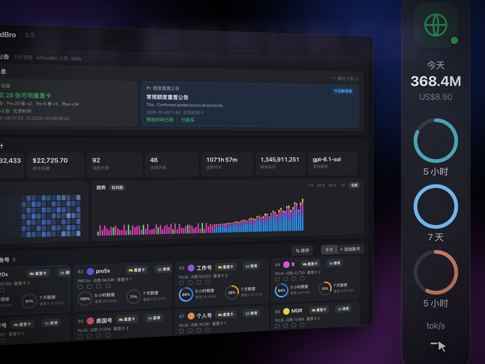</a>
</p>

<a id="tasks"></a>

## 13 · 任务占用、调度和暖号：避免互相抢账号

**它是做什么的：** 任务占用把准备、运行、维护和待验收状态写入本机记录，账号页和调度器据此知道哪些账号正在使用。调度参与时段、优先级和暖号是已有的自动化能力，不等于自动把所有账号派给新任务。

**怎么使用：** 在账号自动化或设置中开启“剩余 1% 自动暂停并换号”或“换号成功后自动继续原任务”；软件会先保存任务与轮次，核验备用账号和任务状态后再切换。暖号会在额度窗口到期后先刷新，再按条件请求，忙碌、低额度或结果不明时等待或暂停。没有可信任务状态时保持关闭，不制造成功通知。

<a id="setup"></a>

## 14 · 工具连接、安装引导和更新提醒

**它是做什么的：** 对可识别的新装或覆盖安装，引导负责把登录、通知连接和新功能设置分开，并询问新用户／老用户。新用户检查完整功能，老用户重点检查微信、飞书和新设置并保留既有配置。无法可靠识别为新安装的原位替换不会强行重复弹窗。手动 Claude 引导不会覆盖安装引导的进度。

**怎么使用：** 打开“使用引导”按步骤连接官方工具；Claude、Kimi、Grok、OpenCode、WorkBuddy、ZCode 和 TRAE SOLO 均按各自官方入口登录。更新弹窗展示版本和更新点，用户点击后下载，校验大小与 SHA256 后再自行覆盖安装；下载不会自动退出或替换当前 App，也不会自动开启可选功能。

**首次安装默认值：** 跟随系统主题、账号卡片、自动隐藏侧栏、菜单栏显示剩余额度与倒计时、K 线展示全部历史、玻璃透明度 74%／深度 84%，主窗口 ⌘U、侧栏 ⌘I。新用户仍进入引导；老用户的全部已有配置保留。仅整理通用界面偏好，不携带账号、凭据、私人路径、端点或授权；通知发送和重置卡自动使用仍需用户选择与授权。详见[首次安装偏好](docs/first-install-preferences.md)。

精选区保留 REA、JEV 等按需安装入口，并在可识别的新装或覆盖后只读检查一次本机安装情况；可逐项隐藏或手动重新检查。检测不代表工具已连接，也不会代替用户安装或调用。关于页增加订阅优惠入口，版本标题读取实际安装信息。

<a id="themes"></a>

## 15 · 主题和原生玻璃

**它是做什么的：** 外观设置统一管理明暗模式、主题颜色、玻璃透明度和层次，解决不同主题下文字不明显的问题；系统“减少透明度”和“增强对比度”优先。

**怎么使用：** 打开“设置 → 显示与图标”，选择主题、语言和玻璃浓度。当前保留九套主题：默认灰、液态键帽、青花瓷、蒙特雷曙霞、千里江山、敦煌飞天、故宫红墙、紫蓝流光、WAICY 流彩。WAICY 主题只使用色值，不复制品牌图形、字体或吉祥物。

<a id="downloads"></a>

## 16 · 下载、升级与构建

macOS 包面向 **macOS 13+、Apple Silicon ARM64**，沿用固定本地签名身份，未做 Apple 公证。Windows x86_64 单独提供 MSI / NSIS EXE，功能范围见 [Windows 说明](windows/README.md)。原有 Release 和安装包保留；9.6.x 旧客户端仍需手动下载覆盖。准备升级时，先结束任务、停止反代、正常退出并备份旧 App 和本机数据；macOS 覆盖后核对 **3.0.0（161）／1028v1**。

构建、包内容、签名与校验值按本次产物独立核验，结果见 [3.0.0 发布记录](docs/release-notes-v3.0.0.md)和 [GitHub Actions](https://github.com/BLACKIELF/AgentHub-AiGoodBro/actions)。本轮发布不替换正在运行的安装版；历史反代断开的底层现场原因、长期真实调用、全部登录和通知送达仍有待实机验收，不用旧版本测试代替本包验证。

以下按本次版本标签构建：

```sh
git clone --branch v3.0.0 https://github.com/BLACKIELF/AgentHub-AiGoodBro.git AiGoodBro-3.0.0
cd AiGoodBro-3.0.0
make build
```

macOS 构建需要 Go 1.26+ 和经 SHA256 校验的 Token Monitor 0.68.0 macOS 运行时；本版在该界面基线上回移指定修复，不提供 Intel Mac 包。Windows 使用自己的 Rust / Tauri / Node 构建流程，见 [Windows 构建说明](windows/README.md)。

<a id="sources"></a>

## 17 · 源码、许可证与文档

下表列出实际复用、适配或静态研究参考的项目；对应许可证和版权声明随仓库保留。借鉴上游功能不等于把上游的测试样例或品牌素材写成 AiGoodBro 的真实能力。

| 项目 | 来源关系 |
|---|---|
| [Tencent/openclaw-weixin 2.4.9](https://github.com/Tencent/openclaw-weixin/tree/24de5c9eb0dd5e595d7e2d090ed8a3f82870d42c) | iLink 协议与扫码流程的原生适配；保留 MIT 声明，不安装 OpenClaw。 |
| [codexU](https://github.com/shanggqm/codexU) | 历史固定源码的二次开发与宿主适配；SwiftUI、额度、配色和 Windows 基础由 AiGoodBro 继续维护。 |
| [Token Monitor v0.68.0](https://github.com/Javis603/token-monitor/tree/5d2db368d8313415763860d594de00e46a663418) | 固定 0.68.0 界面与官方 macOS 运行时的宿主适配；本版选择性回移 0.70／0.71 修复，保留统计引擎、桌面看板、图表及既有设置。 |
| [TokScale 4.18.0 fork](https://github.com/Javis603/tokscale/tree/fa5f0c13324838d1a988fda317597f9b90da7ad0) · [原项目](https://github.com/junhoyeo/tokscale) | 4.18.0 基线与固定扫描器修订，用于统计采集和定价；许可证随包保留。 |
| [CLIProxyAPI v8.0.38](https://github.com/router-for-me/CLIProxyAPI/tree/v8.0.38) | 固定 Go SDK 的调度、Codex 执行器和 Responses 处理器宿主适配；保留身份、额度、点数底线和流式响应不重放检查。 |
| [Codex-Manager](https://github.com/qxcnm/Codex-Manager) | 协议适配与静态研究参考；暖号请求和 SSE 完成规则独立实现。 |
| [Hazmat wrapper 脚本](https://github.com/dredozubov/hazmat/blob/c112d222bb53e888dd17a8927927286792f7c20e/scripts/check-codex-desktop-attach-smoke.sh) | 仅参考 `CODEX_CLI_PATH` 的 stdio wrapper 入口，未集成 Hazmat 沙箱或服务。 |
| [BlackHole1/aswap v1.1.0](https://github.com/BlackHole1/aswap/releases/tag/v1.1.0) | Claude 多账号 CLI／Chrome 资料隔离工具的协议适配与静态参考；未复制、未打包。 |

AiGoodBro 使用 [MIT 许可证](LICENSE)。第三方许可见 [`Resources/THIRD_PARTY_NOTICES.txt`](Resources/THIRD_PARTY_NOTICES.txt)、[`Companion/LocalProxy/LICENSE.CLIProxyAPI`](Companion/LocalProxy/LICENSE.CLIProxyAPI)、[`Companion/LocalProxy/LICENSE.Hazmat`](Companion/LocalProxy/LICENSE.Hazmat) 和 [`Companion/LocalProxy/THIRD-PARTY-NOTICES.txt`](Companion/LocalProxy/THIRD-PARTY-NOTICES.txt)。

文档入口：[详细使用说明](docs/usage-guide.md) · [本机 CLI 额度范围](docs/local-cli-accounts.md) · [反代实现与验证](docs/local-proxy-0928v1.md) · [3.0.0 发布记录](docs/release-notes-v3.0.0.md) · [2.5.2 发布记录](docs/release-notes-v2.5.2.md) · [2.5.1 发布记录](docs/release-notes-v2.5.1.md) · [2.5.0 发布记录](docs/release-notes-v2.5.0.md) · [图片来源与校验](docs/public-ui-1012v1-promo.md) · [问题反馈](https://github.com/BLACKIELF/AgentHub-AiGoodBro/issues) · [安全说明](SECURITY.md)

<a id="actual-screenshots"></a>

## 18 · 实际软件截图

主界面及账号、用量裁图来自已安装的 **2.3.0（137）**；六张登录、引导和设置图来自 **2.3.0（139）**，均为历史界面记录。反代状态局部图未显示版本号。图中数值和连接状态是拍摄时快照，不作为 3.0.0（161）安装、真实调用或消息送达的验收；来源、原始尺寸和校验值见[历史截图记录](docs/public-ui-1009v2.md)。点击图片可查看原图。

### 01 · 主界面

<p align="center">
  <a href="docs/images/1009v1/home-live.png">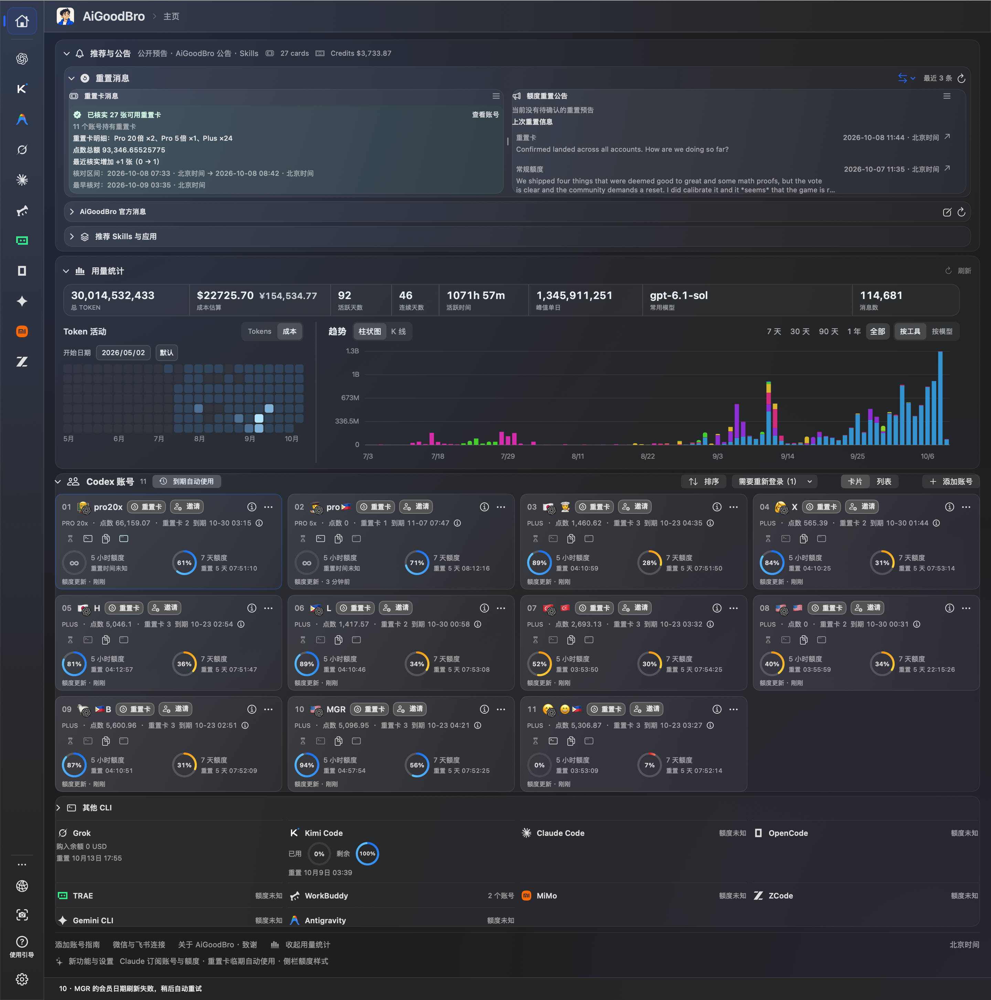</a>
</p>

### 02 · 反代状态与侧栏

<p align="center">
  <a href="docs/images/1009v1/proxy-status-edge-dock.png">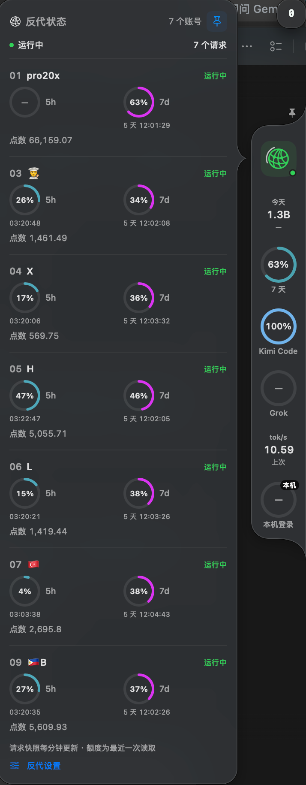</a>
</p>

### 03 · Codex 账号

<p align="center">
  <a href="docs/images/1009v2/accounts-home-137-crop.png">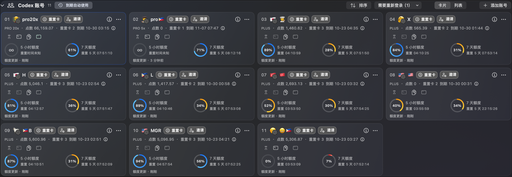</a>
</p>

### 04 · Claude 登录与保存

<p align="center">
  <a href="docs/images/1009v2/claude-login.jpg">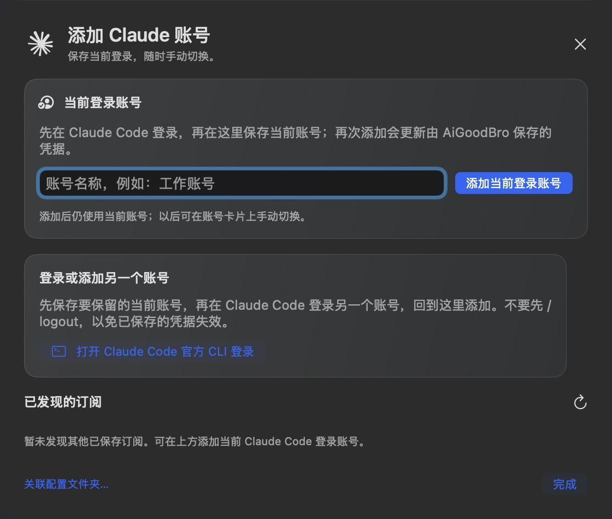</a>
</p>

### 05 · 用量统计

<p align="center">
  <a href="docs/images/1009v2/usage-home-137-crop.png">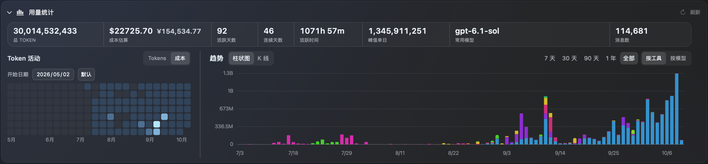</a>
</p>

### 06 · 工具连接引导

<p align="center">
  <a href="docs/images/1009v2/guide.jpg">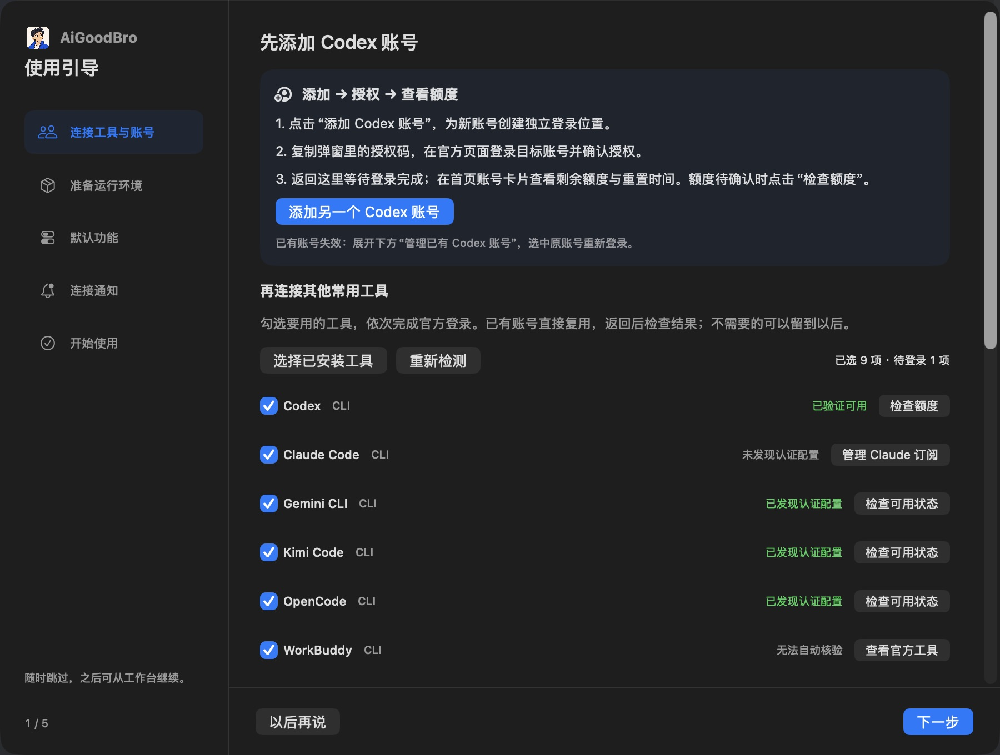</a>
</p>

### 07 · 重置卡自动使用设置

<p align="center">
  <a href="docs/images/1009v2/reset-auto.jpg">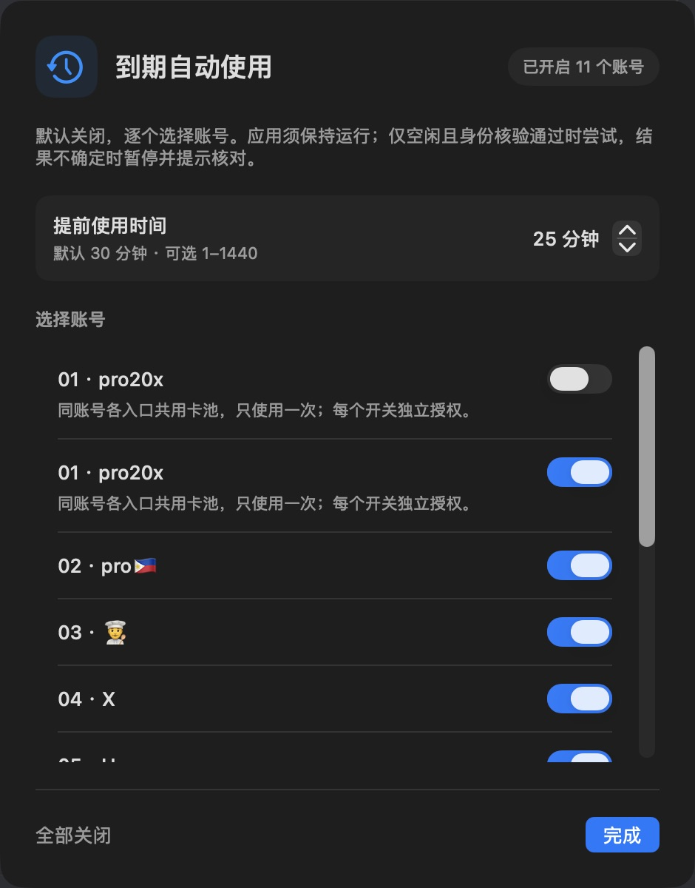</a>
</p>

### 08 · 微信与飞书通知设置

<p align="center">
  <a href="docs/images/1009v2/notifications-guide.jpg">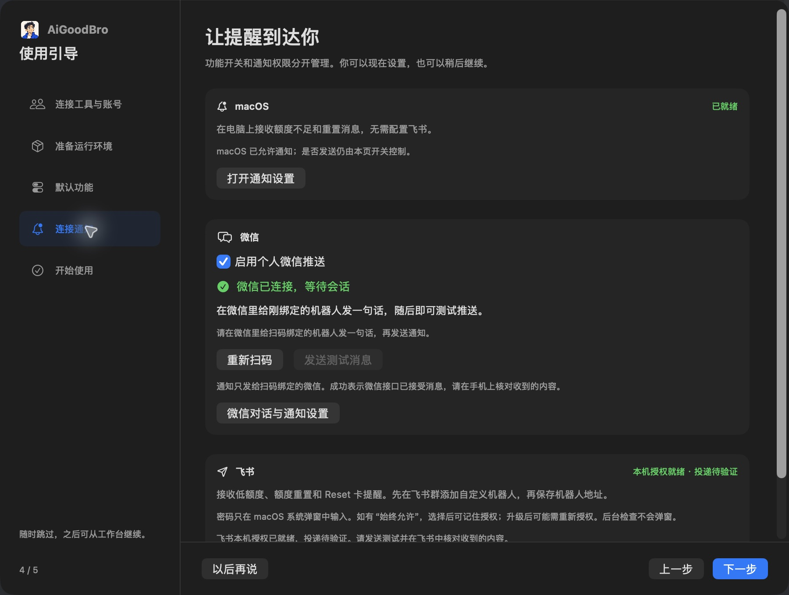</a>
</p>

### 09 · 侧栏设置

<p align="center">
  <a href="docs/images/1009v2/edge-dock-settings.jpg">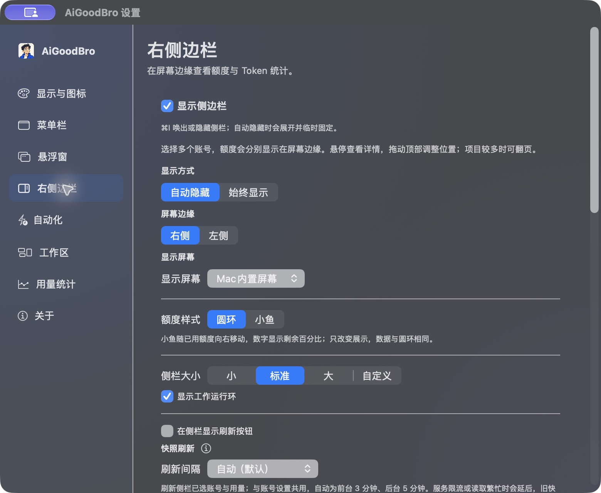</a>
</p>

### 10 · 主题与玻璃设置

<p align="center">
  <a href="docs/images/1009v2/appearance-settings.jpg">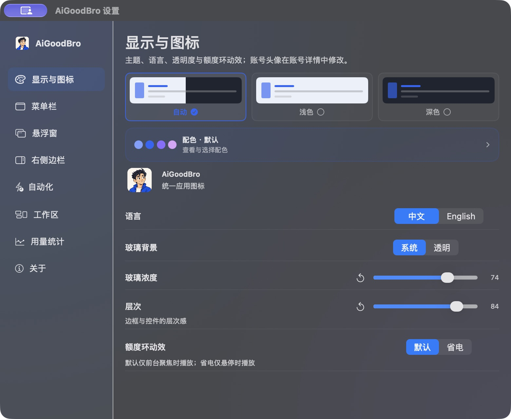</a>
</p>
