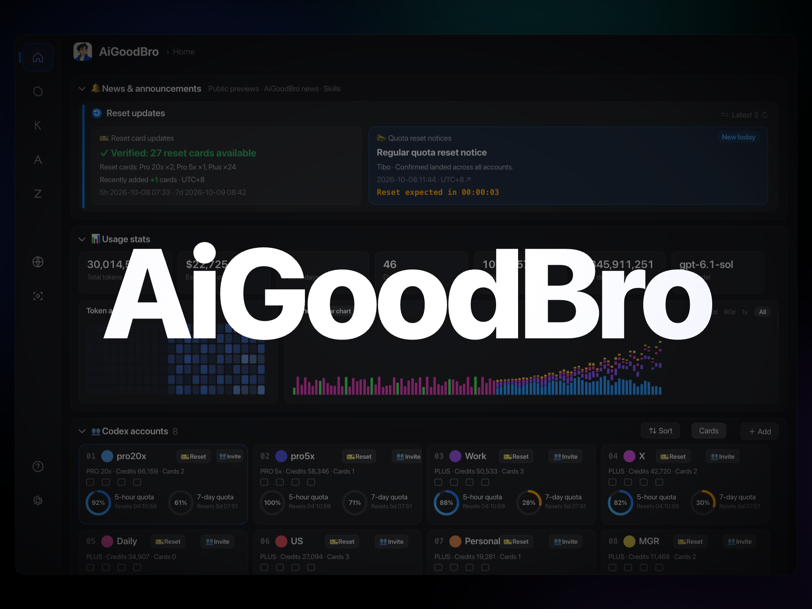

# AiGoodBro · English promotional showcase

The original 48-second English AiGoodBro promotional video, its editable HTML scene, and the interface presentation patterns used in that scene. Package version: **1012v2** · Scene and video version: **1011v1**. The Git directory retains its `1012v1` path.

**This is a scripted promotional UI demonstration.** Account aliases, quota values, usage totals, messages, reset notices, and “Running” states are authored scene content. The package does not run the AiGoodBro application or connect to a live service.

[Download the original video](https://github.com/BLACKIELF/AgentHub-AiGoodBro/releases/download/v2.5.0/AiGoodBro-English-1011v1.mp4) · [Download the complete ZIP](https://github.com/BLACKIELF/AgentHub-AiGoodBro/releases/download/v2.5.0/AiGoodBro-Showcase-1012v2.zip) · [Local player](index.html) · [Editable scene](scene-en-1011v1.html) · [中文说明](使用说明-1012v1.md)

The complete release ZIP includes the original MP4. The Git directory `docs/showcase/1012v1/` carries source, documentation, soundtrack, images, and frames; download the MP4 into `exports/AiGoodBro-English-1011v1.mp4` in that directory before using its local video player.

The archive's approved byte size and SHA-256 are recorded outside the ZIP in the [release integrity record](https://github.com/BLACKIELF/AgentHub-AiGoodBro/blob/main/docs/showcase-release-1012v2.md). Version 1012v2 contains the comparison-report fixes and does not distribute the two standalone service-icon PNGs. [Local image requirements](ui/README.md) explain how to supply authorized resources for an HTML preview or rerender; original MP4 playback is complete without them.



## Explore the presentation

| Interface form | Exact scene interval | What the scene shows | Existing frame |
| --- | --- | --- | --- |
| Dashboard camera tour | 3.04–5.84 s; 19.20–22.40 s | A single app window becomes a sequence of focused views of the banner, KPIs, heatmap, chart, and card grid. | [20.70 s · frame 621](frames/english-0621.png) |
| Reset countdown and confirmation | 6.40–10.40 s | The camera approaches a notice, three countdown digits lead to a status and count change, then the view pulls back. | [7.10 s · frame 213](frames/english-0213.png) |
| Feishu and WeChat notifications | 10.40–16.80 s | A paper-plane cue introduces Feishu cards; Feishu moves left as WeChat enters; messages arrive in sequence. | [15.40 s · frame 462](frames/english-0462.png) |
| Edge quota sidebar | 22.40–26.40 s | A fixed screen-space rail, animated quota rings, a cursor, highlights, ripples, and timed visual feedback. | [24.80 s · frame 744](frames/english-0744.png) |
| Proxy status popover | 26.40–31.20 s | The rail shrinks while an anchored status panel expands over the app window. | [28.20 s · frame 846](frames/english-0846.png) |
| Multiple-account card dive | 31.20–34.40 s | Three camera targets pick out cards from the existing grid; the view returns to the full window. | [31.60 s · frame 948](frames/english-0948.png) |

[Interface forms, mechanisms, and reusable parts](docs/INTERFACE-FORMS.md) · [Full timeline](docs/TIMELINE.md) · [Complete general video-design rules](design-rules/apple-video-design/SKILL.md)

The numbers above describe this scene. They are not universal design defaults. The sidebar’s haptic wording is presented through animation and audio cues; no physical trackpad vibration is implemented by this browser scene.

## Open locally

For the original MP4, open `index.html` in a browser or open the video directly. To preview through a local server, run this from the package directory:

```bash
node serve.mjs 8787
```

Open `http://127.0.0.1:8787/`. The native player offers chapter buttons, an unchanged MP4 download, and an editable-scene link. The scene has Play/Pause and a time slider. Append a numeric hash such as `scene-en-1011v1.html#15.4` to inspect that time.

## Files and reproduction

| Entry | Purpose |
| --- | --- |
| [Original MP4 release asset](https://github.com/BLACKIELF/AgentHub-AiGoodBro/releases/download/v2.5.0/AiGoodBro-English-1011v1.mp4) / [exports guide](exports/README.md) | Original H.264/AAC video, copied without re-encoding: 48.000 s, 1920 × 1440, 4:3, 30 fps, 1440 video frames. Included in the complete ZIP; downloaded separately for a Git checkout. |
| [scene-en-1011v1.html](scene-en-1011v1.html) | Unmodified English scene: interface markup, CSS, camera, titles, scripted states, and animation. |
| [audio/reference-score-1011v1.wav](audio/reference-score-1011v1.wav) | Unmodified 48 kHz stereo soundtrack used in the scene. |
| [score-en-1011v1.py](score-en-1011v1.py) / [cues-en-1011v1.json](cues-en-1011v1.json) | Original procedural audio source and 70 event cues. |
| [assets/](assets/) / [local image requirements](ui/README.md) | The unchanged AiGoodBro avatar is included. Feishu and WeChat icons are required local rendering inputs, not standalone files in this distribution. |
| [frames/](frames/) | Eight original 1920 × 1440 production render frames, copied unchanged. These are scene render stills, not captures of a running app. |
| [render.mjs](render.mjs) / [serve.mjs](serve.mjs) | Portable local rendering and playback tools; use already installed runtimes. |
| [ORIGINALS.json](ORIGINALS.json) | Fourteen retained original files plus two required external image inputs, with SHA-256, sizes, roles, frame timestamps and system-font declarations. The MP4 is a separate release asset in a Git checkout. |
| [FILES-SHA256.txt](FILES-SHA256.txt) | SHA-256 for every other file in the complete release ZIP. A Git checkout intentionally omits the listed MP4 binary. |
| [docs/REPRODUCE.md](docs/REPRODUCE.md) | Preview, representative-frame, short-clip, full-render, and optional audio-generation instructions. |
| [design-rules/apple-video-design/SKILL.md](design-rules/apple-video-design/SKILL.md) | Complete general workflow rules, separate from this scene’s measured parameters. |

No package or browser installation is performed by the tools. Rendering requires existing Node.js, Playwright/Playwright Core, Chromium or Chrome, and FFmpeg. The original soundtrack can be reused without Python; optional audio regeneration additionally requires Python 3 and NumPy. Font files are not distributed; different system fonts can change text and pixels on another machine.

Original video SHA-256:

```text
e236788e272f5b722284b5505df2263dd70ef53bb3b962211a6258cd031e30b3
```

[Origins and integrity](docs/PROVENANCE.md) · [Validation scope](docs/VALIDATION.md)
