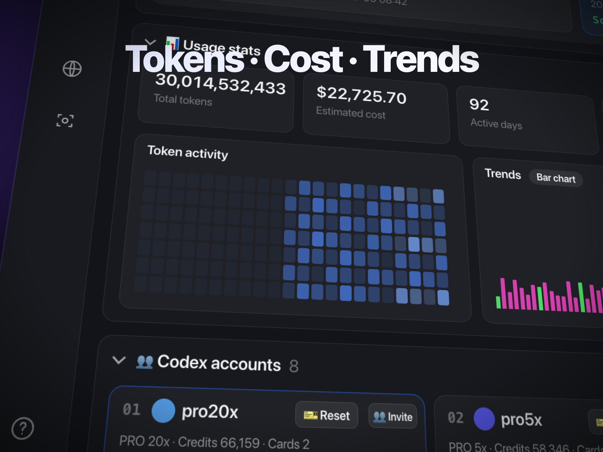
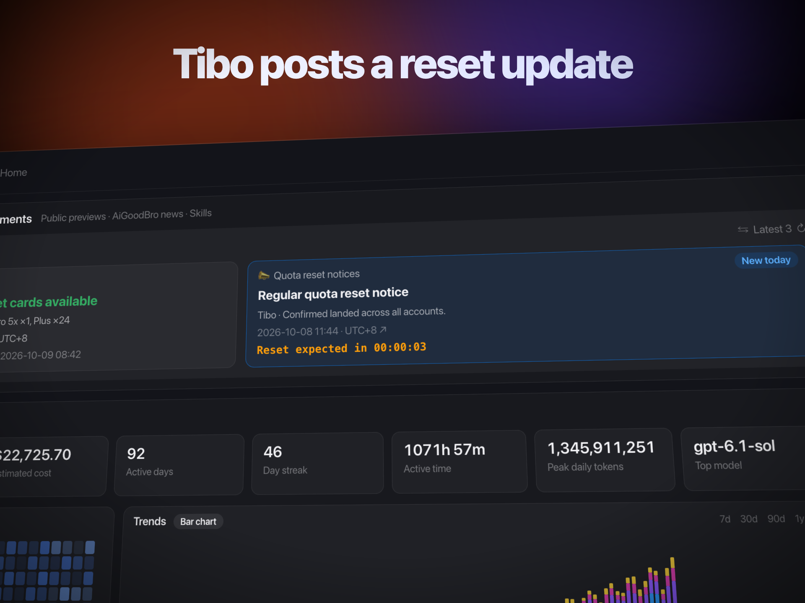
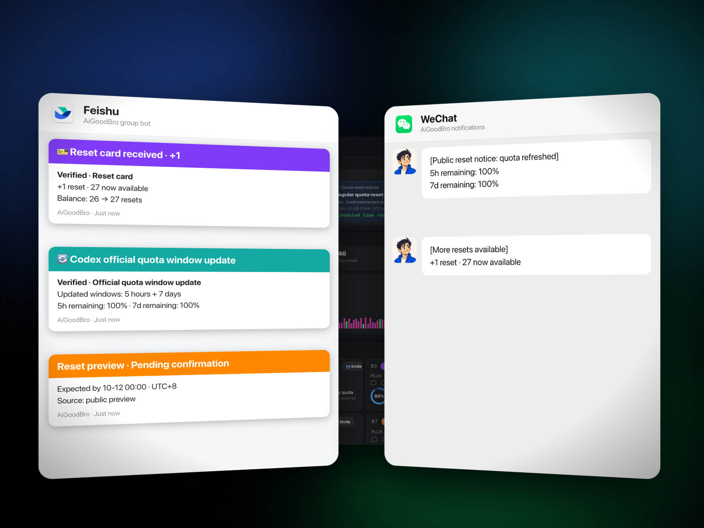
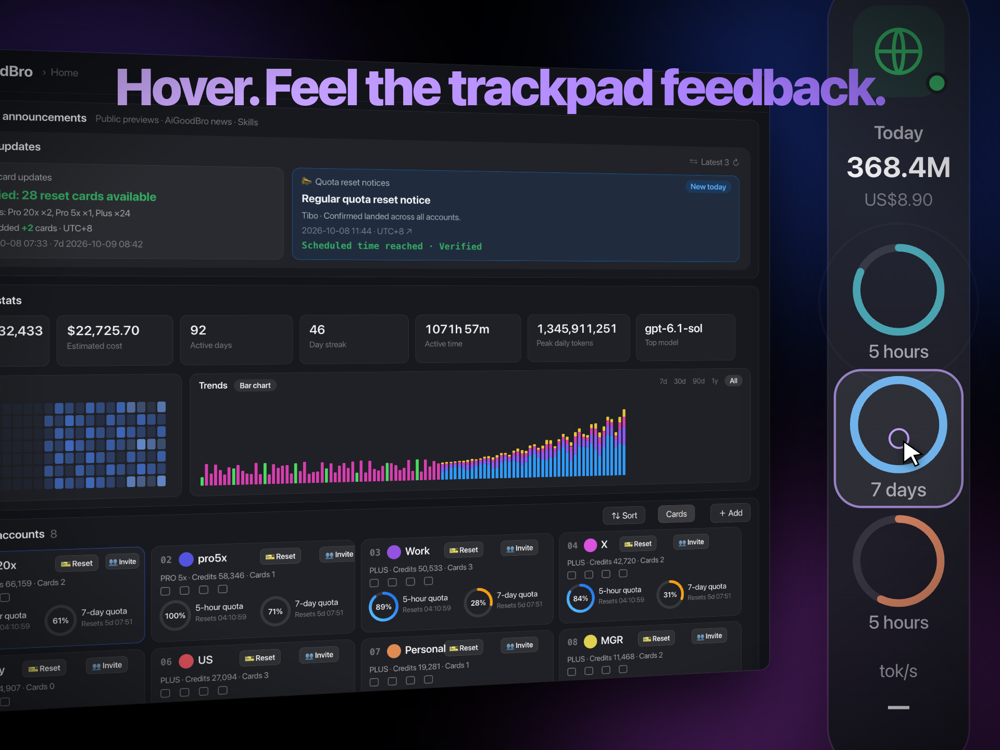
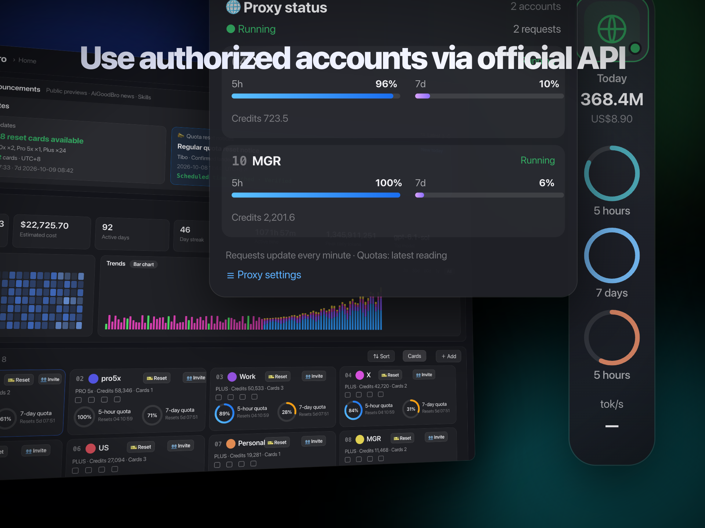
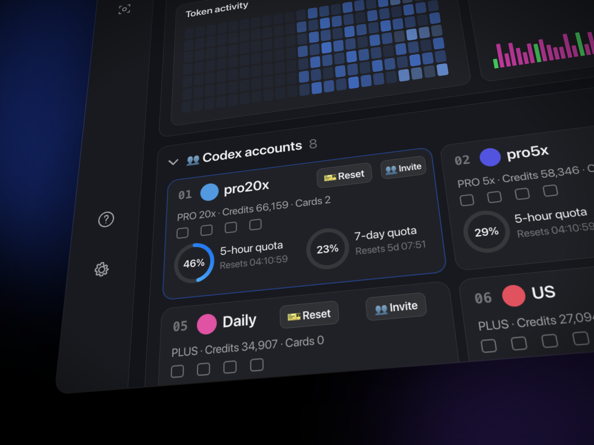

# Interface forms in the AiGoodBro promotional scene

These forms are identified in the unmodified [English scene](../scene-en-1011v1.html). Images below are original production render stills from that scene, copied at 1920 × 1440. All displayed data and states are scripted promotional content.

The source clock is `B = t / (60 / 150)`: 150 BPM, 0.4 seconds per beat, 120 beats, 48 seconds. The published video is 30 fps. [TIMELINE.md](TIMELINE.md) lists the exact ranges. This scene uses fixed pixel geometry; the mechanisms can be reused while its numbers remain case-specific.

## 1. One dashboard, several camera views

**Where:** the introductory skim at 3.04–5.84 s and the usage section at 19.20–22.40 s. Representative frame: **20.70 s, frame 621**.

The app is one 2200 × 1520 pixel `#win` inside a 1920 × 1440 stage. `K` stores camera keys as `[beat, x, y, scale, rotX, rotY, rotZ]`, where x/y name the window point placed at screen center. `camAt()` interpolates adjacent keys with the cubic `io()` easing; `applyCam()` combines translation, rotation, and scaling. `camVel()` controls canvas streak opacity and brief window blur during faster moves.

The stats section visits the KPI strip, heatmap, stacked bars, and card grid. Bar scale is computed from time and bar index; heatmap opacity is computed from time and cell index. The source retains one spatial model while changing the viewer’s focus.

**Reusable parts:** a stable parent window, explicit subject-center coordinates, camera keys in one clock, perspective, staggered chart fills, and a speed-derived motion treatment. The chart, heatmap, and totals in this source are authored values and geometry rather than a live analytics pipeline.

## 2. A notice becomes a timed state change

**Where:** 6.40–10.40 s. Representative frame: **7.10 s, frame 213**.

The camera first centers the reset banner, approaches the announcement block, then returns to the whole banner at beat 22.35 (8.94 s). `scene()` updates `#annCd` from the source clock. `drawBigCd()` overlays the digits 3, 2, and 1 at beats 19–22 (7.60–8.80 s), with scale, opacity, and blur driven by each digit’s phase. At beat 22 (8.80 s), the notice switches to its scripted confirmation text; the card count changes from 27 to 28 and two blocks receive a decaying glow.

**Reusable parts:** an inline status as a spatial anchor, a separate emphasis layer for critical seconds, one explicit state boundary, synchronized ticks, and a return camera target. The rendered word “Verified” is a scripted label and does not certify an external quota event.

## 3. Notifications move from one service view to two

**Where:** 10.40–16.80 s, inside the notification section ending at 19.20 s. Representative frame: **15.40 s, frame 462**.

`chats()` uses separate screen-space `#fsApp` and `#wxApp` panels over the app window. A paper plane follows a time-defined arc at 10.40–11.04 s. Feishu enters through translation, rotation, and scale; its three cards start at 11.60, 12.20, and 12.80 s. At 13.60–14.00 s Feishu moves left and scales to 0.86 as WeChat enters. WeChat messages start at 14.60, 15.20, and 15.80 s. Each card/bubble uses the damped `spr()` function for its vertical offset and scale while opacity has a separate short reveal.

**Reusable parts:** per-service containers, screen-space composition, a panel handoff that retains the first service, content stagger, and distinct notification cues. The local HTML builds all cards and messages; it does not send or receive Feishu/WeChat messages.

## 4. A quota rail demonstrates focused hover feedback

**Where:** 22.40–26.40 s. Representative frame: **24.80 s, frame 744**.

`dock()` shows the rail over the app from beat 56 to 78 (22.40–31.20 s), with its dedicated hover sequence before beat 66. `ring()` builds SVG tracks and arcs using `pathLength="100"`; `setRing()` sets arc length from the authored remaining percentage and reveal phase. The cursor visits cells, while the active cell gets a border/background, a decaying lateral shake, scale, and an expanding ripple. Five audio events occur at 24.00, 24.40, 24.80, 25.20, and 25.60 s.

**Reusable parts:** a screen-space rail independent of the app camera, normalized SVG ring progress, a planned cursor route, focused cell styling, and timed visual/audio feedback. The browser scene does not drive physical haptics; the wording in the video is demonstrated with visual effects and an audio cue.

## 5. An anchored popover expands from the rail

**Where:** 26.40–31.20 s. Representative frame: **28.20 s, frame 846**.

The rail scales down between beats 66 and 67.2 (26.40–26.88 s). At beat 67 (26.80 s), `dock()` makes `#pop` visible beside the rail; opacity rises at 26.88–27.04 s and a damped scale transition progresses through 27.36 s. Its transform origin is the upper-right area, linking the panel’s movement to the rail. The scene’s panel shows two rows, quota bars, credits, and request text.

**Reusable parts:** a visible anchor, coordinated anchor/panel scale, transform origin near that anchor, grouped quota bars, and a single reveal/fade interval. “Running,” request counts, and quota bars are scripted presentation values; the package has no proxy implementation or API validation.

## 6. Account cards supply the targets for a close-up sequence

**Where:** 31.20–34.40 s. Representative frame: **31.60 s, frame 948**.

`ACC` creates eight cards in a four-column grid. Every card has an alias, plan text, badges, credits, card count, and two remaining-quota rings. Camera targets start at 31.60, 32.40, and 33.20 s, selecting cards in the existing grid before returning to the full window by beat 85 (34.00 s). The first card’s selected outline and repeated ring/badge structure let the viewer follow the same component at different scales.

**Reusable parts:** one reusable card constructor, a consistent quota-ring component, explicit selected state, grid coordinates as camera targets, and a return to the whole collection. Aliases and quantities belong to the promotional scene; they are not private account exports or queried balances.

## Titles and closing support these interface forms

`T()` builds title objects with beat ranges; `drawTitles()` computes visibility, scale, blur, gradient position, and backdrop opacity. These title layers punctuate the interface sequence without requiring replacement images. The English title widths are measured against stored reference widths when `sceneReady` resolves. The four closing lines enter at 37.60, 38.20, 38.80, and 39.40 s, begin their common exit at 46.10 s, and disappear at 46.40 s.

[Opening frame · 2.00 s](../frames/english-0060.png) · [Closing frame · 44.00 s](../frames/english-1320.png) · [Reproduction](REPRODUCE.md) · [Package guide](../README.md)
